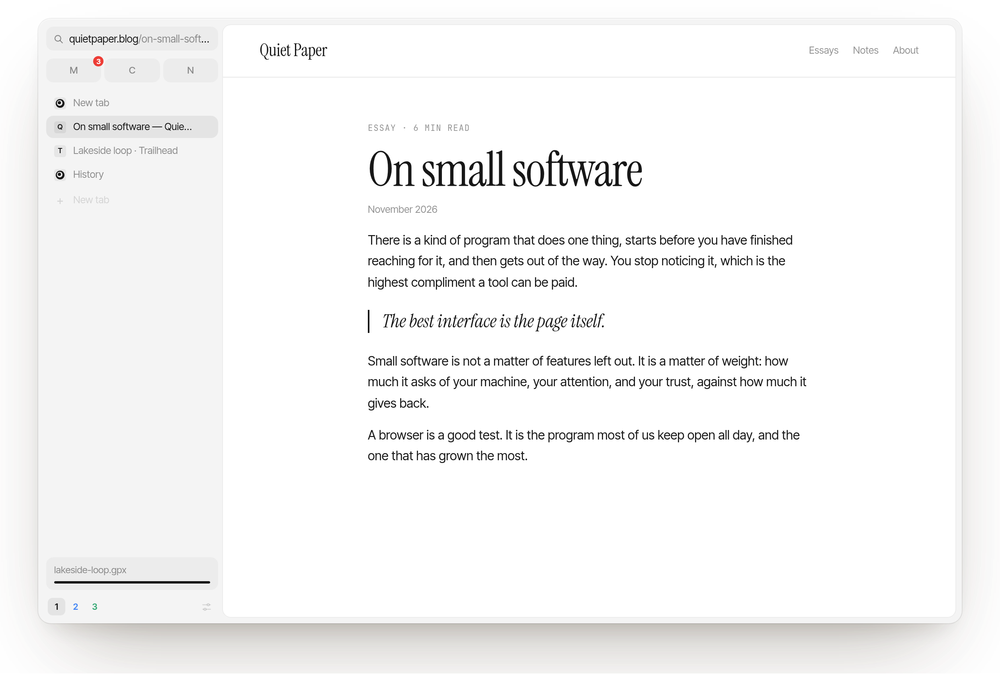

<p align="center"></p>

# rippl

A small, fast, private web browser for Linux, built on WebKit (WebKitGTK 6.0 + GTK4) and written in Rust.

A column of tabs, one field, and the page as a card: the look of another browser,
the macOS browser it's modelled on. No account, no telemetry, no server. Ads and trackers are blocked
inside WebKit before they load, and tabs you aren't using give their memory back.

<picture>
  <source media="(prefers-color-scheme: dark)" srcset="docs/images/preview-dark.png">
  
</picture>
<p align="center"><sub>The window as drawn on <a href="https://ripplbrowser.web.app">ripplbrowser.web.app</a>.</sub></p>

## Size and speed

A 1.2 MB binary on the system's WebKitGTK (about 195 MB with WebKitGTK and GTK, against 430–480 MB
for Chromium, Chrome or Brave). Ready in ~0.35 s; a first page in ~0.5 s. With every tab awake a
WebKit page costs more than a Chromium one; with background tabs asleep, ten heavy sites take
~950 MB against 1,245 MB for Brave and 1,489 MB for Chromium. All the numbers, including where rippl
loses: [docs/performance.md](docs/performance.md).

## Why it uses less memory

Most of a browser's memory is its web processes, one per open page. rippl keeps as few of them alive as
it can:

- **Lazy restore.** Tabs from the last session cost nothing until you click them.
- **Tabs sleep.** A tab unseen for 30 minutes ends its web process and keeps its history and scroll
  position, so it comes back where you left it.
- **Memory pressure.** rippl reads Linux PSI. When memory is tight, idle tabs sleep sooner, and at once
  when it is critical.
- **Shield.** EasyList, EasyPrivacy and uBlock Origin's lists (~130k rules) are compiled into WebKit's
  own content filters, with no script in pages.
  On an ad-heavy page that saved **20–47% of memory**, and the page loads less.
- **Per-process limits** and heap trimming.

## Everyday things

The field offers your open tabs, bookmarks and history as you type, ranked by how you use them, and
completes addresses you've visited (`you` → `youtube.com`). Downloads go to `~/Downloads`, never
overwriting a file, and are listed at the foot of the column. Find in page, permission prompts that
remember your answer per site, and light/dark mode. Pinned tabs, a reading mode that runs no script,
anything on a page hidden for good with one click, and history, bookmarks and settings as pages of
their own. Bookmarks come over from Chrome, Brave, Edge, Vivaldi, Firefox, LibreWolf or Zen.

Videos: `Ctrl+Shift+Y`, paste a link from YouTube, Vimeo or any site yt-dlp knows, and Return. It
comes down through [yt-dlp](https://github.com/yt-dlp/yt-dlp) (installed separately) as `.mp4`, or
as `.mp3` with `Shift+Return`, into the downloads list with pause, resume and cancel.

Passwords live in your system keyring (GNOME Keyring), never in rippl's files. rippl offers to save
a sign-in only once it has worked, offers saved accounts under the box when you click it (on that
exact site only), and never fills anything on its own.

## Private by default

DuckDuckGo search (or Brave, Startpage, Mojeek, Qwant, or your own SearXNG). Every request is
upgraded to HTTPS and carries Global Privacy Control ("do not sell or share my data"). Third-party
cookies are blocked, WebKit's tracking prevention is on, and cross-site pings are blocked. Nothing leaves your
machine except the pages you open and the filter-list updates. Details: [docs/privacy.md](docs/privacy.md).

## Install

```sh
sudo pacman -S --needed webkitgtk-6.0 gtk4 libsecret   # Debian/Ubuntu: libwebkitgtk-6.0-dev libgtk-4-dev libsecret-1-dev
scripts/install.sh            # builds, and installs into ~/.local: the app, its icon, its desktop entry
```

Then open rippl from your launcher, and make it your default browser from its welcome page or
Settings › General. `scripts/install.sh /usr` (with sudo) installs for everyone;
`scripts/install.sh --uninstall` takes it away again (your settings and data stay).
Arch: [packaging/arch/PKGBUILD](packaging/arch/PKGBUILD) (`makepkg -si`). Flatpak:
[packaging/flatpak](packaging/flatpak/dev.rippl.Rippl.yml).

To run it from the source folder without installing: `cargo build --release && ./target/release/rippl [url…]`
(the web extension is built beside the binary; rippl finds it there).

`Ctrl+L` address · `Ctrl+T` new tab · `Ctrl+W` close · `Ctrl+Shift+N` private tab · `Ctrl+Tab` tab switcher ·
`Ctrl+1`–`9` jump · `Alt+←/→` back/forward · `Ctrl+F` find · `Ctrl+D` bookmark · `Ctrl+H` history ·
`Ctrl+Shift+P` pin · `Ctrl+Alt+S` split view · `Ctrl+Alt+P` passwords · `F9` reading mode · `Ctrl+Shift+H` hide something · `Ctrl+,` settings ·
`Ctrl+Shift+B` Shield off for this site · `Ctrl+S` hide tabs.
All keys and settings: [docs/configuration.md](docs/configuration.md).

## Documentation

Everything is in [docs/](docs/README.md): [architecture](docs/architecture.md), [privacy](docs/privacy.md),
[configuration](docs/configuration.md), [testing](docs/testing.md), the [roadmap](docs/roadmap.md), and
one page per finished phase in [docs/phases/](docs/phases/).

Inspired by another browser, a WebKit browser for the Mac: its look, and its
features as far as Linux allows ([docs/features.md](docs/features.md)).
