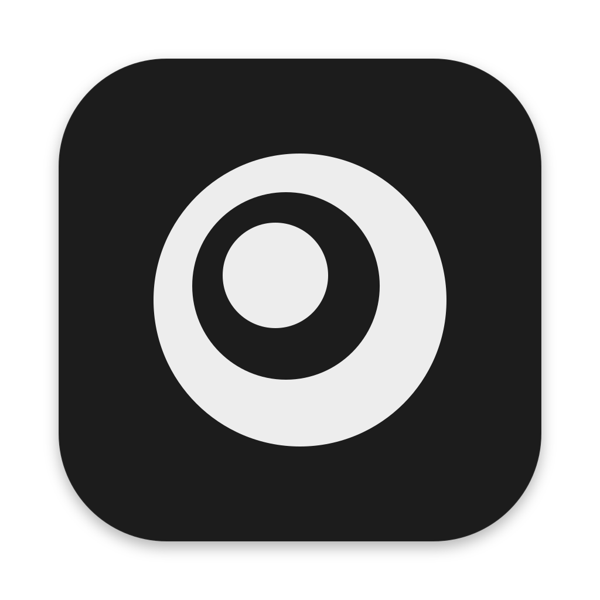

# Phase 9: shipping — logo, desktop entry, default browser, install, packages, welcome

**Status:** done (2026-11-26).

## The logo

 

One bold ink shape on a white plate: **a ripple**. A drop, and one ring around it set a little off its
centre, so the ring is thicker on one side, as a wave is just after the drop lands. Ink `#171717`
on a white plate on Apple's grid (824 of 1024, corners 22.37%, a soft shadow).

Four ideas were drawn and checked at 256, 32 and 16 pixels before choosing: a drop and a centred
ring (read as a target), a drop and two arcs (read as a sound or Wi-Fi icon), nested pills (too
plain), a ripple seen on the water (busy at 16). The off-centre ring is the one that
is simple, its own, and still clear at 16 pixels: each step out from the drop's centre (the drop
24 px off the middle, the ring's hole 34, on a 1024 canvas) gives the ring its 56–124 px weight.

Files (`data/`):

- `icons/hicolor/scalable/apps/dev.rippl.Rippl.svg`, and PNGs at 16–512 (rendered with
  `rsvg-convert`), the app's icon by its id;
- `icons/hicolor/symbolic/apps/dev.rippl.Rippl-symbolic.svg`, the mark alone, for panels;
- `logo/rippl.svg` and `logo/rippl-dark.svg` (a white mark on rippl's dark ground).

The window takes the icon by name; run from a build folder, rippl adds `data/icons` to the icon
theme's search path so it shows before it is installed. The welcome page shows the logo too.

## Desktop entry and AppStream

`data/dev.rippl.Rippl.desktop`: a web browser for `http`, `https` and HTML files, with **New
Window** and **New Private Window** actions (`--new-window`, `--private-window`).
`data/dev.rippl.Rippl.metainfo.xml` for software centres. Both validate
(`desktop-file-validate`, `appstreamcli validate`).

## Links from other apps

A second `rippl <url>` while rippl runs used to only bring the window forward. Now (windows.rs,
`launched_again`) its addresses open as new tabs of the window in front, `--new-window` opens a
window, `--private-window` a private tab.

## Default browser

Settings › General › Default browser, and the welcome page: **Make default** runs `xdg-settings
set default-web-browser dev.rippl.Rippl.desktop` and `xdg-mime default` for `http`, `https`,
`text/html` and XHTML (desktop.rs). Offered only once rippl is installed (its desktop entry
found); run from a build folder, it says to install first.

## Installing

`scripts/install.sh [prefix]` builds the release and installs: `bin/rippl`,
`lib/rippl/librippl_web_extension.so` (rippl now also looks in `../lib/rippl` beside its binary),
the desktop entry, the AppStream file, the icons; then refreshes the icon cache and the desktop
database. `~/.local` by default (no root), `/usr` with sudo, `DESTDIR` for packages,
`--uninstall` to take it all away (settings and data stay).

## Packages

- **Arch**: `packaging/arch/PKGBUILD` (`rippl-git`, from the `craft` branch): `cargo fetch
  --locked`, release build, core tests, then `install.sh` into the package.
- **Flatpak**: `packaging/flatpak/dev.rippl.Rippl.yml` on GNOME's runtime (WebKitGTK 6.0 is in
  it), with network, Wayland, sound, GPU, the keyring, portals, MPRIS, and Downloads. Crates come
  as sources from `flatpak-cargo-generator` (a Flatpak build is offline).

## Welcome

The first launch opens rippl://welcome (once; a `welcomed` file marks it): the logo, what rippl
is, and the five things worth doing first (default browser, bring things over, blocking and
sleeping already on, Settings), a few keys, and **Start browsing**, which closes it into a new
tab. It is in the field's page commands as "Welcome" afterwards.

## Also

- `LICENSE`: MIT, as `Cargo.toml` already said.
- README: the logo, and Install before running from source.
